# DeskLens

Visor y editor local de proyectos y archivos, con pestañas, buscador y un chat de IA que gasta pocos tokens.
Todo corre en tu ordenador: un servidor pequeño en Python (solo biblioteca estándar, sin instalar nada) y una ventana web.

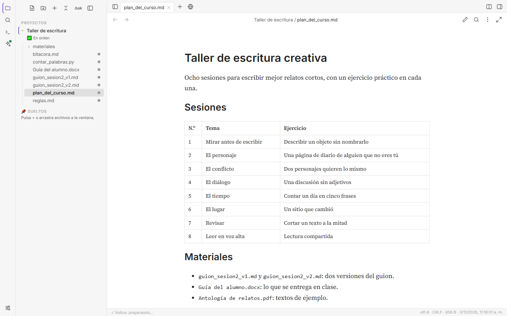

## Qué hace

- **Explorador** de proyectos y archivos sueltos, con estado de git y pestañas como en VS Code.
- **Git** como en VS Code: preparar, commit, ramas, merge, pull y push, y comparar versiones en 2 o 3 columnas.
- **Leer** casi cualquier formato: Markdown, código, tablas (CSV, JSON…), HTML, Word, PDF, imágenes, audio, vídeo y letras.
- **Editar**:
  - texto y código (CodeMirror), conservando la codificación y los saltos de línea;
  - Word: texto, negrita, cursiva, subrayado, color e imágenes;
  - imágenes: girar, voltear, recortar, cambiar tamaño, brillo y contraste;
  - PDF: añadir texto, resaltar, girar, mover y borrar páginas.
- **Historial de cambios** (↶ ↷) en disco: sobrevive a guardar y cerrar, y se borra solo a los N días.
- **Buscador** en nombres y contenido (SQLite FTS5), también dentro de PDF y Word.
- **Consola** para ejecutar scripts y las pruebas del proyecto.
- **Chat de IA** con Claude Code, Codex o Gemini CLI usando tu propia suscripción. DeskLens adjunta solo lo necesario (el archivo abierto, las páginas pedidas de un PDF, una selección) y nada se envía sin que pulses Enviar.
- Copias de seguridad: `.bak` la primera vez que se guarda, recuperación de lo no guardado y «Deshacer» de los cambios de la IA.
- **Vista dividida**, **comparador** de archivos y **pestaña web**.

## Capturas

Las capturas usan un proyecto de ejemplo inventado, «Taller de escritura».

**Vista dividida.** Dos pestañas lado a lado: aquí, un PDF y un Word. Cada lado tiene sus pestañas, y una pestaña se arrastra de un lado al otro.
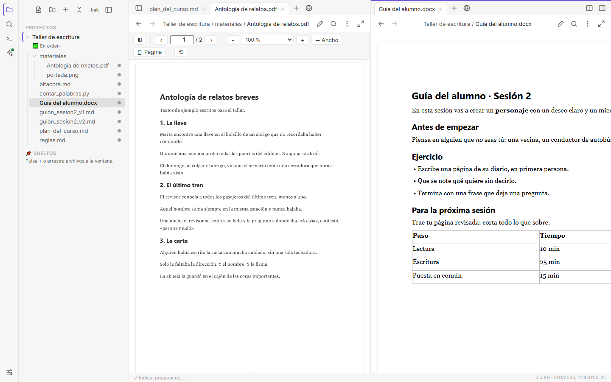

**Comparar dos archivos.** En rojo, lo que solo está en el primero; en verde, lo que solo está en el segundo, con las palabras exactas marcadas. Con la flecha ➜ se copia un cambio y se guarda.
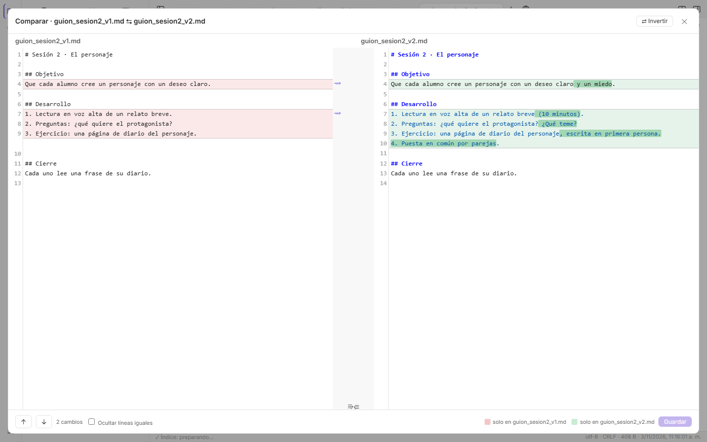

**Comparar versiones con git.** Los commits de un archivo en 2 o 3 columnas, con fecha, autor y mensaje. Tiene lista de cambios, mapa, una raya del color de cada autor y los archivos que tocó cada commit. Con ↩ se recupera una versión.
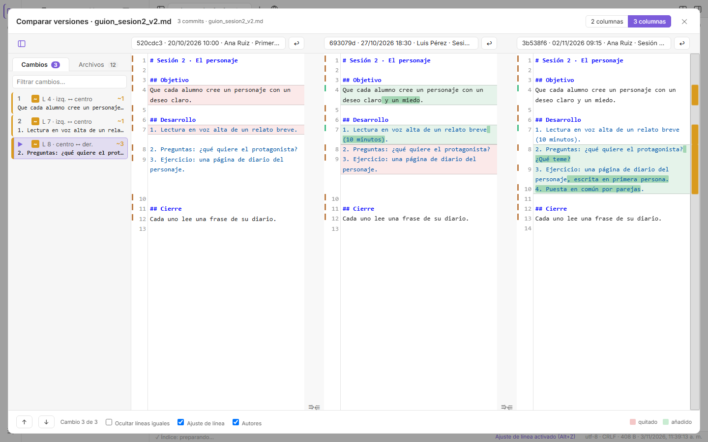

**Editar un Word** sin salir de DeskLens: texto, negrita, cursiva, subrayado y color.
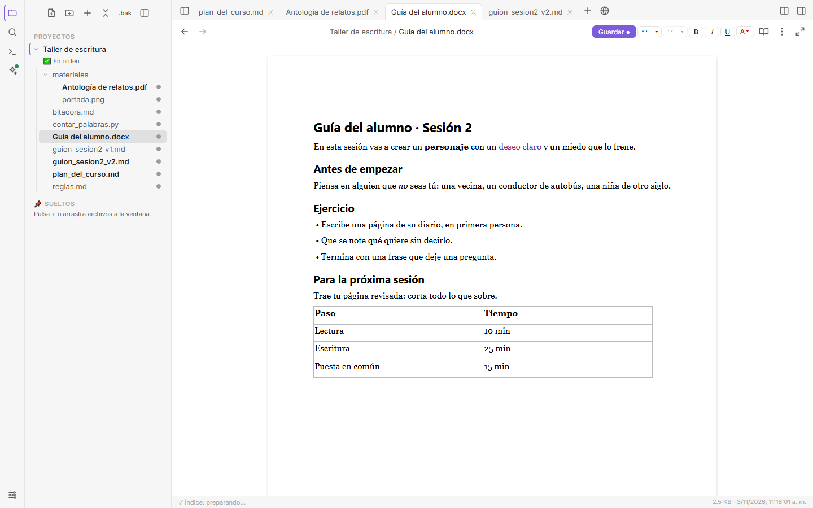

**Historial de cambios.** Cada paso queda en disco, con su vista previa. Se puede deshacer o rehacer hasta cualquier punto, incluso después de guardar y cerrar.
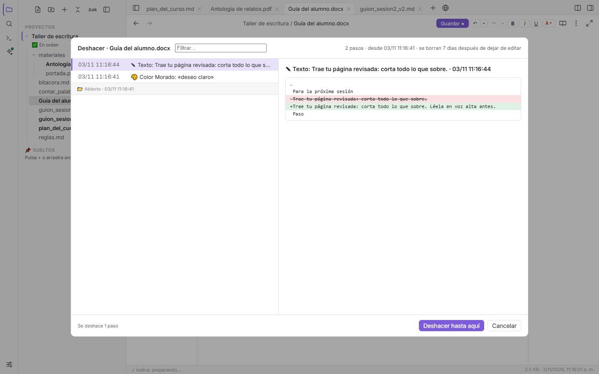

**Editar imágenes:** girar, voltear, recortar, cambiar el tamaño, brillo y contraste.
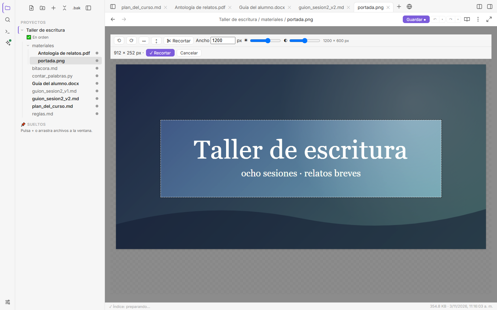

**Editar PDF:** añadir texto, resaltar, y girar, mover o borrar páginas.
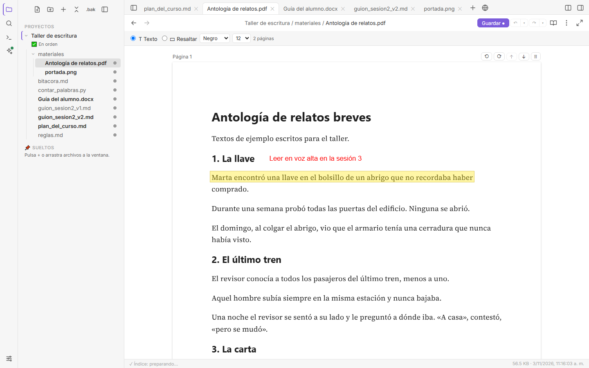

**Pestaña web** junto a tus documentos, con favoritos y el buscador que elijas en Ajustes.
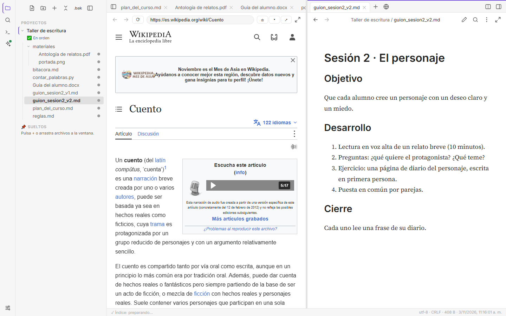

**Chat de IA** que adjunta solo lo necesario. Antes de enviar ves qué archivos van y cuántos tokens gastarán.
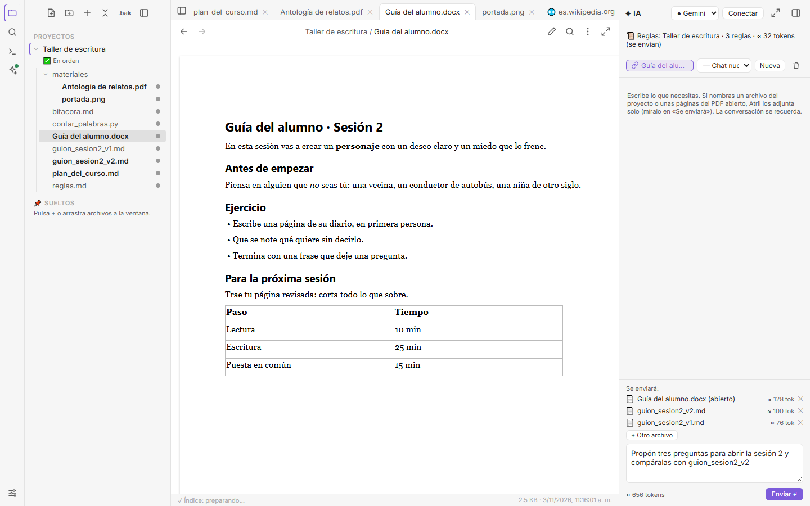

**Consola** para ejecutar scripts y las pruebas del proyecto.
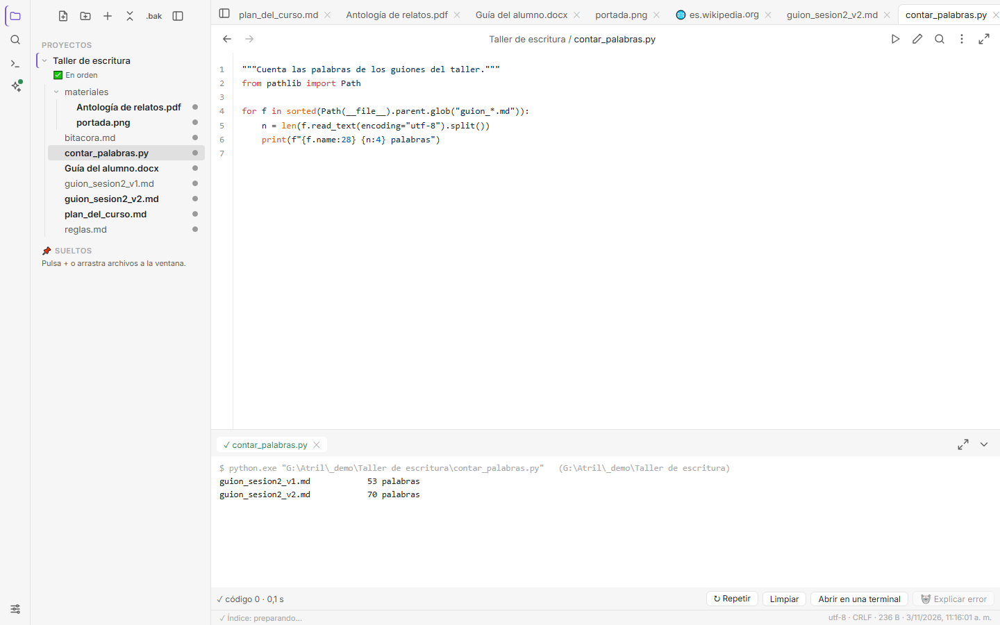

## Requisitos

- **Python 3.10 o más nuevo**.
- **Un navegador Chromium** para la ventana y para crear PDF: Microsoft Edge (viene con Windows), Google Chrome, Chromium o Brave. Cuál usar se elige en ⚙ Ajustes › General (también «Navegador predeterminado»). Sin ninguno, DeskLens se abre en tu navegador de siempre.
- Internet la primera vez que se abre un PDF o un Word: sus visores se cargan de una CDN (ver [TERCEROS.md](TERCEROS.md)).
- Opcional, para el chat: [Claude Code](https://docs.anthropic.com/claude-code), [Codex](https://github.com/openai/codex) o [Gemini CLI](https://github.com/google-gemini/gemini-cli).

## Instalar y abrir

Descarga el repositorio (botón **Code → Download ZIP** o `git clone`) y:

**Windows, la primera vez:** doble clic en **`instalar.bat`**. Revisa e instala (preguntando antes cada cosa) Python, Git y, si quieres, las herramientas de IA; crea el acceso directo «DeskLens» y ejecuta las pruebas. Con `instalar.bat -SoloRevisar` solo muestra qué hay y qué falta. Todo sale de winget (Microsoft) y npm; el script está comentado paso a paso.

| Sistema | Cómo abrirlo |
|---|---|
| **Windows** | Doble clic en `desklens.pyw`. Arrastra archivos sobre él para abrirlos. |
| **macOS** | Doble clic en `desklens.command` (la primera vez: clic derecho → Abrir). |
| **Linux** | `./desklens.sh` (o `python3 desklens.pyw`). |

Para usarlo como servidor sin ventana: `python3 desklens.pyw --sin-ventana` y abre `http://127.0.0.1:8765/`.

Estado: probado en **Windows 10** y **Linux** (Debian, Python 3.12). En **macOS** está preparado pero aún sin probar: si lo usas en Mac, cuéntanos cómo va.

## Tus datos

- `config.json`: tus proyectos y ajustes.
- `historial/`: conversaciones, índice de búsqueda, recuperación y versiones.

Los dos se crean junto a `desklens.pyw` y **no** se suben al repositorio (`.gitignore`). DeskLens solo sirve los archivos de las carpetas que añades y solo escucha en `127.0.0.1`.

## Para desarrollar

- `python3 test_desklens.py` → «OK: todas las pruebas pasan».
- Diseño y decisiones: [implementacion_desklens.md](implementacion_desklens.md) · formatos: [formatos_desklens.md](formatos_desklens.md) · diario de cambios: [bitacora.md](bitacora.md).
- Normas del proyecto: [reglas.md](reglas.md).

## Licencia

[MIT](LICENSE). Las bibliotecas que usa la ventana tienen sus propias licencias: [TERCEROS.md](TERCEROS.md).
